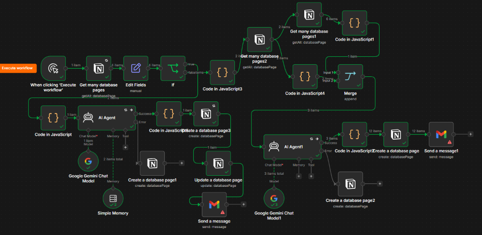
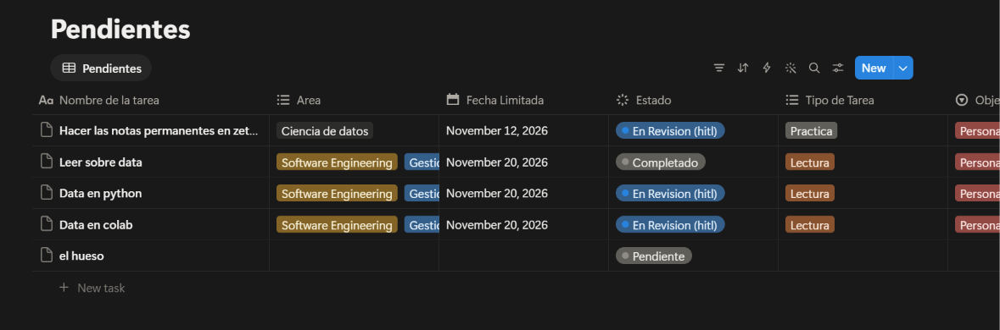
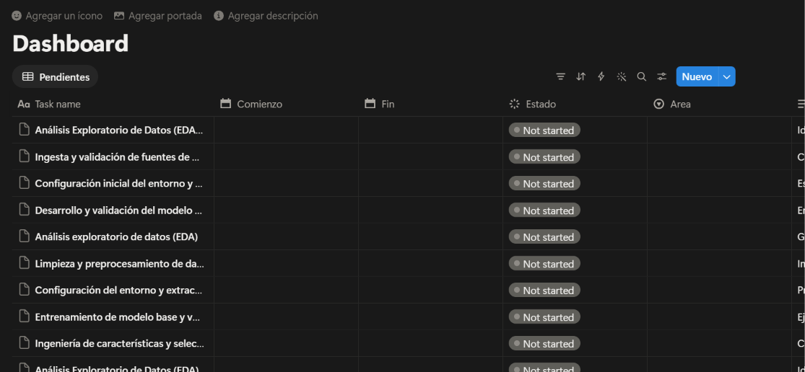
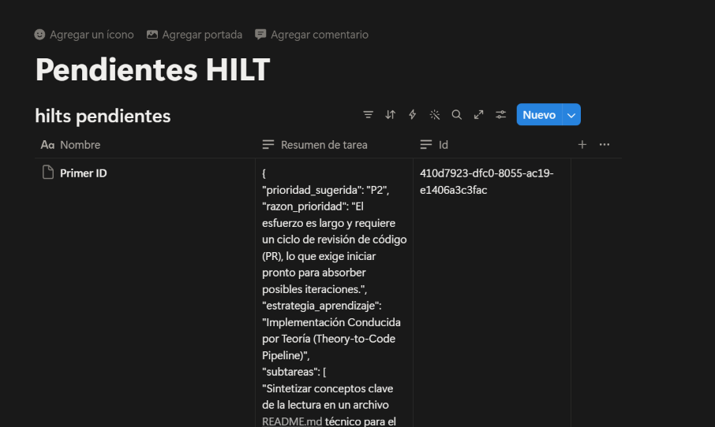
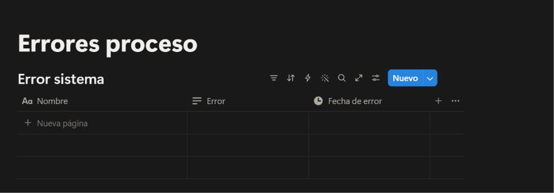

# proyecto_final_ai_automation

## Descripcion
Desarrolle un flujo de trabajo en n8n, con base de datos en notion, integracion con gemini, y notificacion con gmail. 

### Objetivo
El objetivo de este flujo es poder ayudar con la organizacion de tareas que tengo y que voy agregando en el dia a dia. En el dia a dia voy agregando tareas, y cada tanto voy revisando y organizandome segun prioridades, urgencia, etc. La idea es poder automatizar este proceso y que me ayude a mantenerme organizado y enfocado en lo que realmente importa. A parte de evitar sesgos propios y usar a la AI como un profesional de la gestion. Sin perdon el control, claramente este flujo tiene un hilt.

### Flujo detallado

1. Desencadenante y Lectura Inicial (Trigger & Input)

- When clicking ‘Execute workflow’: Es el nodo de inicio manual. Al ejecutarlo, activa el flujo.   

- Get many database pages (Notion): Se conecta a una base de datos de Notion llamada "Pendientes" y extrae todas las páginas (tareas) cuyo estado no sea "Completado".   

- Edit Fields: Mapea y limpia las propiedades obtenidas de Notion (ID, nombre de la tarea, área, tipo de tarea, objetivo, entregable, fecha límite, esfuerzo y estado) para estandarizarlas en variables limpias.  

2. Condicional Principal (If)

- If: Evalúa el estado de las tareas filtradas:   

- Si la tarea NO está pendiente (camino inferior): Extrae sus IDs, busca registros asociados en una base de datos de Notion llamada "hilts pendientes", y prepara el terreno para evaluar su contexto actual frente al tablero.   

- Si la tarea SÍ está pendiente (camino principal/izquierdo): Continúa hacia el bloque de procesamiento inteligente.

3. Rama de Procesamiento con IA (Tareas Pendientes Nuevas o Activas)

- Code in JavaScript (Filtro y cálculo de fechas):   

- Filtra aquellos elementos que contengan valores vacíos, nulos o arrays vacíos para asegurar que la IA reciba datos limpios.

- Calcula de forma dinámica cuántos días faltan para la fecha de finalización (dias_restantes), evalúa si está vencida e indica un estado de fecha ("Vencida", "Vence hoy" o "En plazo").

- AI Agent (con Google Gemini Chat Model y Simple Memory):   

- Actúa como un experto en productividad, optimización del aprendizaje y gestión de proyectos (enfocado en perfiles técnicos).

- Toma los datos de la tarea y aplica reglas estrictas (por ejemplo: si el objetivo es un "Career Switch (DS)" y la tarea es de lectura/teoría, prioriza sugerir convertirla en una práctica de código ejecutable, como un Jupyter Notebook).

- Genera un JSON estructurado con una prioridad sugerida (P1, P2, P3), estrategia de aprendizaje, subtareas ejecutables (máximo 4) y una sugerencia práctica.

- Manejo de errores: Si ocurre un fallo en el agente, un conector alternativo (error output) guarda el reporte del error automáticamente en una base de datos de Notion llamada "Error salida agente 1".   

4. Registro y Notificación de la Tarea Analizada

- Code in JavaScript 5: Parsea el JSON devuelto por el Agente de IA para dejarlo listo para su inserción.   

- Create a database page 3 (Notion): Guarda el resultado del análisis de la IA creando una nueva página en la base de datos "hilts pendientes", guardando el ID y el resumen estructurado de la tarea.   

- Update a database page (Notion): Actualiza el estado de la tarea original en Notion a "En Revision (hitl)" (Human-in-the-Loop).   

- Send a message (Gmail): Envía un correo electrónico a facundoveronjobs@gmail.com notificando que la tarea fue analizada correctamente y se encuentra pendiente de aprobación.   

5. Rama de Sincronización y Replanificación con el Dashboard (AI Agent 1)

Cuando el flujo procesa tareas ya existentes o rescatadas por el nodo If:

- Get many database pages 2 y Get many database pages1 (Notion): Consultan bases de datos auxiliares y el "Dashboard" general de Notion para conocer qué tareas se están ejecutando actualmente.   

- Code in JavaScript 1 & 4: Estructuran tanto el estado actual del Dashboard como los resúmenes anteriores para unificarlos.

- Merge: Combina ambas fuentes de información (el estado actual del tablero y las tareas a integrar).   

- AI Agent 1 (con Google Gemini Chat Model 1):   
- Actúa como experto en PKM (Personal Knowledge Management) y gestión de proyectos.
- Compara el análisis previo con el estado real del Dashboard para evitar colisiones de fechas.
- Genera un array JSON optimizado con fechas de inicio y fin (YYYY-MM-DD), prioridades y descripciones de estrategia ajustadas.
- Manejo de errores: Al igual que el primer agente, si falla, registra el incidente en la base de datos de Notion "Error salida agente 1".   

6. Cierre e Inserción en el Backlog
- Code in JavaScript 2: Limpia los bloques de marcado Markdown (```json) que la IA suele devolver por defecto y convierte el texto plano en elementos independientes de n8n.   
- Create a database page (Notion): Inserta de manera automatizada las nuevas tareas organizadas, con sus respectivas fechas de comienzo/fin, área y descripción de estrategia, directamente en el Dashboard de Notion.   
- Send a message 1 (Gmail): Envía una notificación final por correo electrónico a facundoveronjobs@gmail.com confirmando que la tarea ha sido agregada exitosamente al backlog del Dashboard.   

#### Resumen del propósito general

Este flujo es una potente página de control autónoma. Básicamente toma tus tareas pendientes de Notion, las pasa por un filtro inteligente con IA para desglosarlas en pasos accionables y adaptarlas a objetivos de estudio/transición profesional (como Ciencia de Datos), revisa tu calendario/tablero actual para evitar solapamientos, las reprograma inteligentemente, las registra en Notion y te mantiene al tanto vía correo electrónico de cada cambio o revisión necesaria.

## Files
El archivo ´My workflow 2 (2).json´ contiene todo el flujo del programa n8n.

## Evidencia
Foto del flujo


Foto de base de pendientes: 


Foto de base de dashboard:


Foto de base de pendientes HILT:


Foto de base de Errores de proceso:


## Base de datos

### Dashboard: 

Qué hace en el flujo: 
Es consultado al inicio de la segunda parte (Get many database pages 1 y Get many database pages 2) para conocer el estado actual de todas tus tareas activas. Posteriormente, el nodo Create a database page escribe y programa aquí las tareas definitivas ya optimizadas.   

Para qué sirve: 
Es tu tablero central de control y ejecución. Permite que el segundo agente de inteligencia artificial conozca tu carga de trabajo actual en tiempo real para agendar las nuevas subtareas en las fechas correctas sin colisionar con lo que ya tienes planeado.

Link:
https://app.notion.com/p/40fd7923dfc0801a9198e552519b98e0?v=39dd7923dfc083178c07889252cd9875&source=copy_link


### Pendientes

Qué hace en el flujo: 
Es el punto de partida principal. El nodo Get many database pages se conecta aquí para extraer todas las tareas que no estén marcadas como "Completado".   

Para qué sirve: 
Funciona como tu bandeja de entrada o repositorio central de tareas brutas o por procesar. Almacena los datos originales de lo que tienes pendiente (objetivos, áreas, tipos de tarea, fechas límite y esfuerzo estimado) antes de que la IA los analice.

Link:
https://app.notion.com/p/0db88401ef7e4c30bbe1921111e3639c?v=a2ec85c955bf4d8a889f295a078e354c&source=copy_link

### Pendientes HILT

Qué hace en el flujo: 
Recibe los datos procesados por el primer agente de IA (AI Agent). El nodo Create a database page 3 guarda aquí el resultado del análisis estructurado, el ID de la tarea y el resumen detallado en formato JSON generado por Gemini.   

Para qué sirve: 
Actúa como un espacio de almacenamiento intermedio o etapa de revisión (HITL - Human-in-the-Loop). Guarda el desglose inteligente y los pasos recomendados de cada tarea para que puedas validarlos antes de que pasen formalmente a ejecución.

Link: 
https://app.notion.com/p/Pendientes-HILT-410d7923dfc0801097c5e7206b8ab6ae?source=copy_link

### Error salida agente 1

Qué hace en el flujo: 
Está conectado mediante los manejadores de errores (error output) de ambos nodos de agentes de IA (AI Agent y AI Agent1). Si ocurre algún fallo al generar el texto, al parsear un JSON o por problemas de conexión, este nodo registra automáticamente el error aquí.   

Para qué sirve: 
Es una bitácora de control de errores o debugging. Te permite auditar de forma centralizada qué falló, en qué nodo exacto ocurrió el problema y cuál fue el mensaje de error, facilitando el mantenimiento del flujo sin que la automatización falle silenciosamente.

Link:
https://app.notion.com/p/Errores-proceso-410d7923dfc080eca293d654561048bf?source=copy_link
